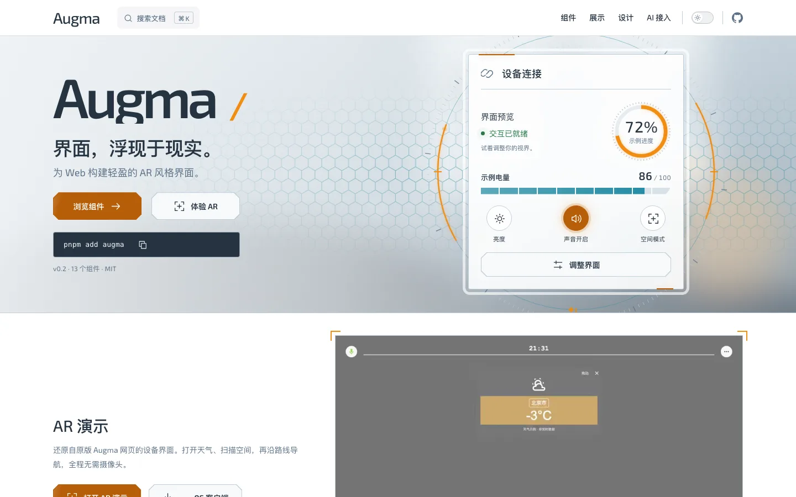
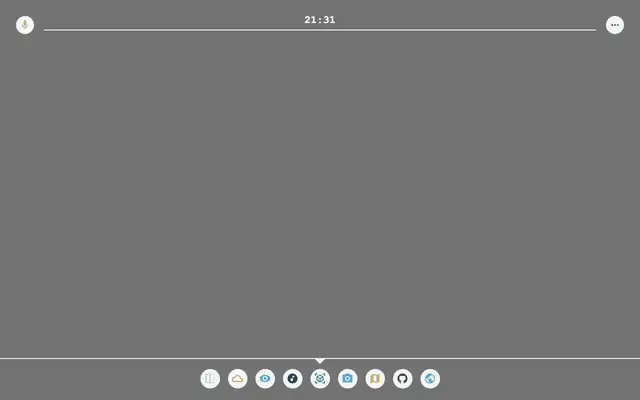

# Augma



为 Web 构建轻盈的 AR 风格界面。设计参考《刀剑神域：序列之争》中 Augma 设备的透明面板、环形状态和轻量交互。

- 主站：[augma.yyj.moe](https://augma.yyj.moe)
- 展示、组件文档、AI 接入统一维护；AR 演示独立构建到 `/ar/`。
- AR 演示（还原自原版 Augma 网页的设备界面）：

  

- `@augma/core` 提供无框架运行时依赖的 tokens / CSS；`augma` 提供 Vue 3.5+ 组件。

## 使用

```sh
pnpm add augma
```

```vue
<script setup lang="ts">
import { AgmButton, AgmPanel } from 'augma'
import 'augma/style.css'
</script>

<template>
  <AgmPanel title="连接设备">
    <AgmButton>开始连接</AgmButton>
  </AgmPanel>
</template>
```

上面的 API 对应 0.2.0（2026-10-20 发布）。从 0.1 升级前请先阅读[迁移指南](apps/site/guide/migration.md)。

只需样式时安装 `@augma/core`，导入 `@augma/core/tokens.css` 或 `@augma/core/style.css`。

## AI 编程接入

```sh
npx skills add YunYouJun/augma --skill augma
```

本地 Skill 位于 [skills/augma/SKILL.md](skills/augma/SKILL.md)。组件示例、API 文档、Registry、`components.json` 和 llms 索引共用正式源码与契约。首版不包含站内模型调用。

## 开发

需要 Node 24，packageManager 固定 pnpm 12.5.1。

```sh
pnpm install --frozen-lockfile
pnpm generate
pnpm build:lib
pnpm dev          # 主站 http://127.0.0.1:3002
pnpm dev:ar       # AR http://127.0.0.1:3003/ar/
```

```sh
pnpm build       # CSS / Vue + 主站 + AR，组合到 apps/site/.vitepress/dist
pnpm preview     # http://127.0.0.1:4317
pnpm check       # lint、types、unit、build、包消费、Registry 与浏览器验证
```

首次浏览器测试前执行 `pnpm exec playwright install chromium firefox webkit`。摄像头需要 HTTPS 或 localhost；WebXR 还需要支持设备与浏览器。

## 结构

- `packages/core`：语义 tokens 与组件样式。
- `packages/augma`：13 个 Vue 组件及类型。
- `apps/site`：VitePress 展示与文档。简体中文位于根路径，English 与日本語译文位于 `/en/`、`/ja/`；组件页由 `pnpm generate` 根据 `scripts/catalog.mjs` 及其译文 `scripts/catalog-i18n.mjs` 生成。
- `apps/ar`：摄像头、HUD、按需加载的 WebXR 演示。
- `examples/components`、`examples/compositions`：展示、源码复制与测试的共同示例。`examples/en-US`、`examples/ja-JP` 是 `/en/`、`/ja/` 使用的译文副本，除文案外须与中文示例保持一致（`tests/components/examples.test.ts` 会检查）。
- `scripts/catalog.mjs`：组件描述与行为说明；API 类型与默认值从 Vue 源码提取。
- `skills/augma`：可安装的 Agent Skill。

版本变化见 [更新记录](CHANGELOG.md)。发布、域名与旧站迁移见 [发布说明](docs/release.md)。0.1 → 0.2 是不兼容重构，详见 [迁移指南](apps/site/guide/migration.md)。

MIT · 原创界面实验，与《刀剑神域》版权方无关联。
